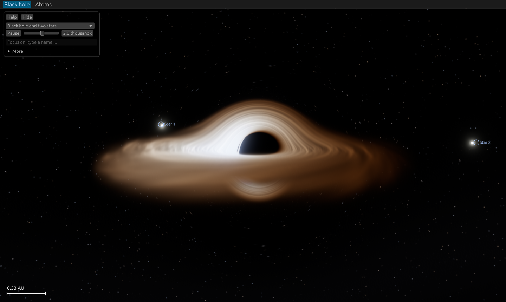

# Physics Sim

A black hole, gravity, and atoms simulator in Rust.

## Run

You need Rust (https://rustup.rs).

    git clone https://github.com/Guntikiwritescode/rust-black-hole
    cd rust-black-hole
    cargo run --release

F1 shows the controls. `cargo run --release -- --scene atoms` starts on the Atoms tab.

`cargo test --release` runs the tests.

## Data

- Atoms: NIST SRD 141 (https://www.nist.gov/pml/atomic-reference-data-electronic-structure-calculations) and the NIST Atomic Spectra Database (https://physics.nist.gov/asd)
- Molecules: NIST CCCBDB, https://cccbdb.nist.gov
- Crystals: Haas, Tran and Blaha, Phys. Rev. B 79, 085104 (2009)
